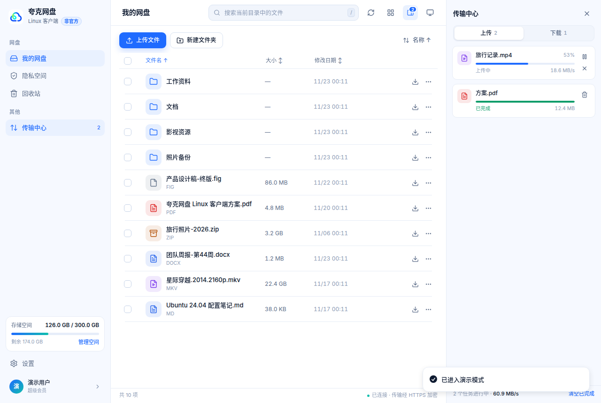
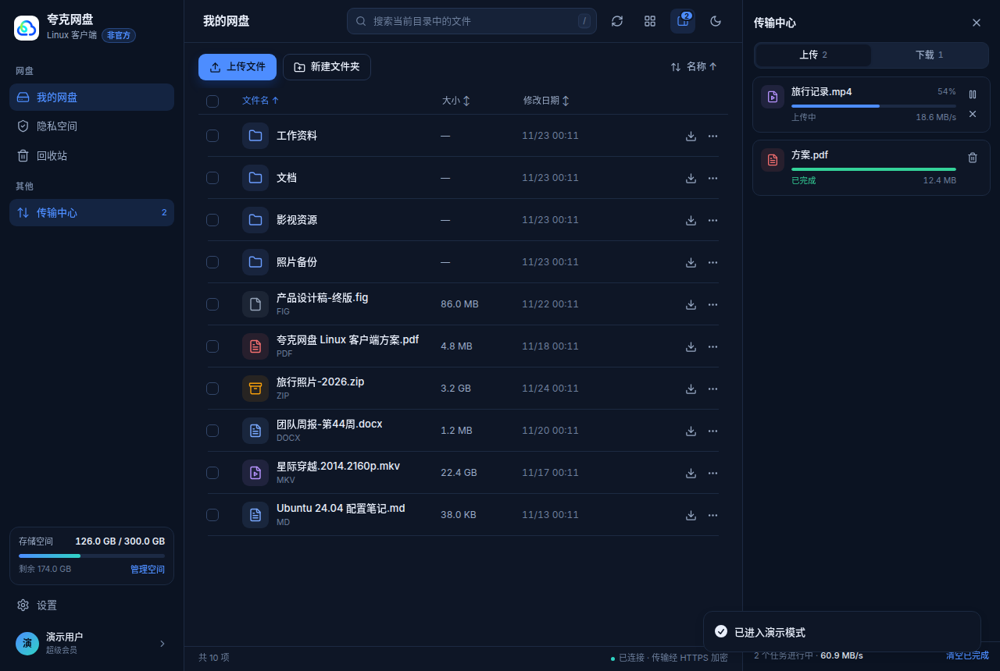
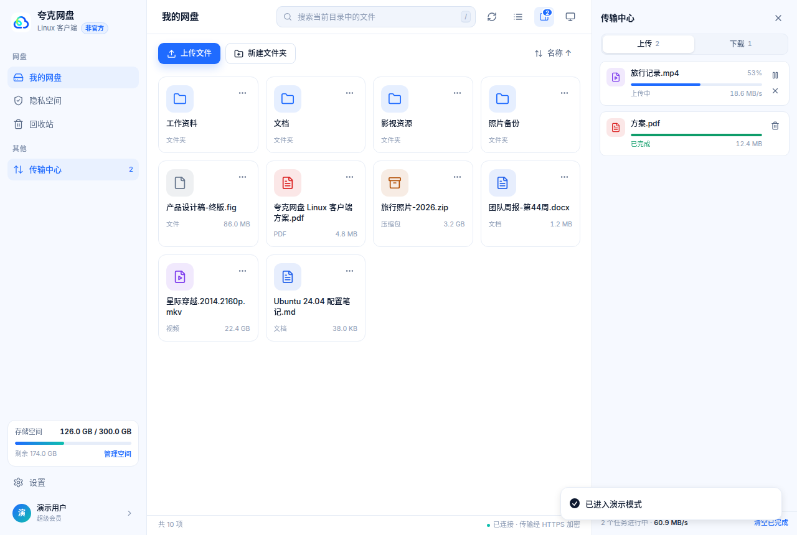
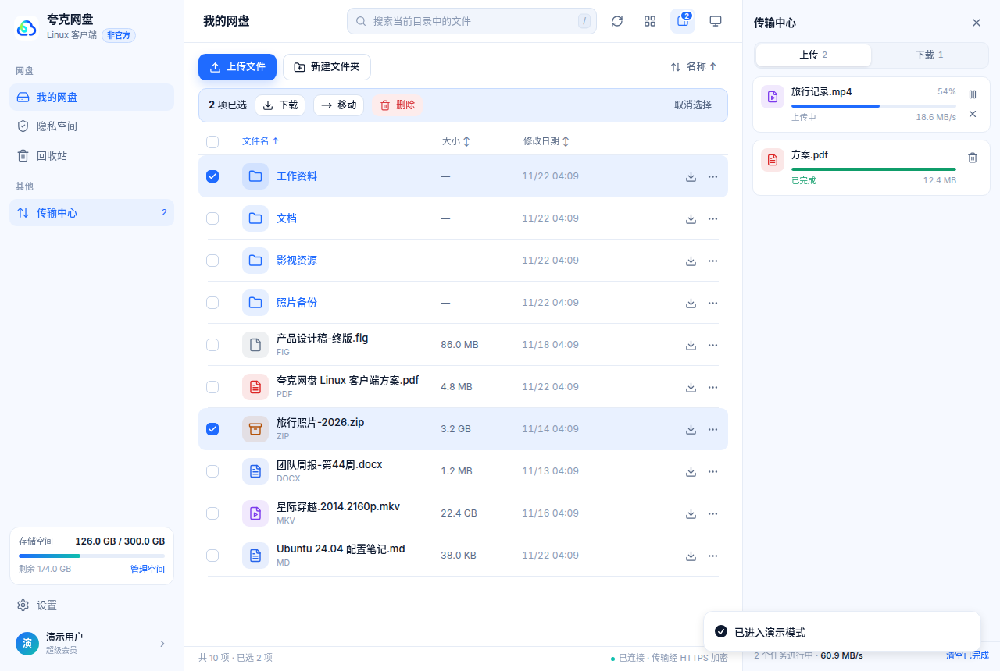
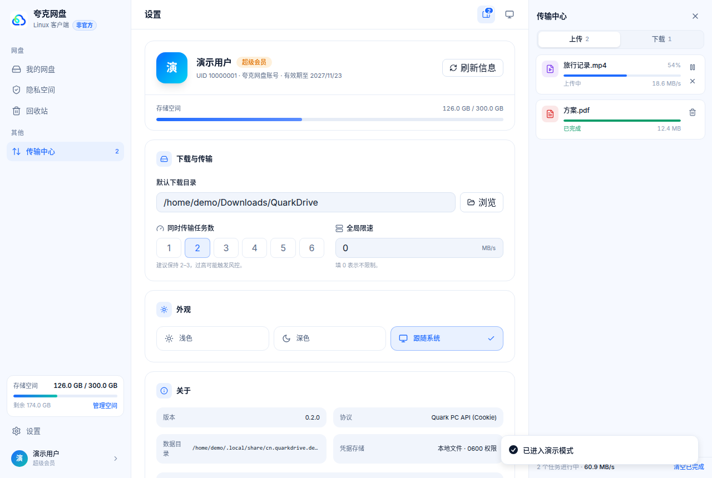

# QuarkDrive · 重设计版

夸克网盘 Linux 桌面客户端。本仓库是 [xingzhe11011/quark-drive](https://github.com/xingzhe11011/quark-drive)（MIT）的界面重设计分支：保留上游 Rust 后端，重做了 React 前端，并加入系统托盘与后台传输。

> 非官方第三方客户端，与夸克官方无任何关联。接口来自夸克网页端，可能随官方更新失效。请只操作自己的账号数据，并保留本地备份。
>
> 本项目仅用于个人账号的文件管理，不绕过会员、限速或付费能力。使用前请自行确认符合夸克服务条款；由此产生的账号或数据风险由使用者承担。
>
> 本分支的界面与交互改动见 [REDESIGN.md](REDESIGN.md)。夸克名称与图标归其权利人所有，仓库中的官方图标仅用于标识这个非官方客户端；如你计划再分发，请自行评估商标使用。

## 下载

- [GitHub Releases](https://github.com/zyst221/quark-drive-redesign/releases)：当前版本 0.2.2。
- Debian / Ubuntu / KDE neon：

  ```bash
  sudo apt install ./QuarkDrive_0.2.2_amd64.deb
  ```

- 其他发行版请按下方“构建”自行编译；校验值随每个 Release 的 `SHA256SUMS` 提供。

## 功能

本分支新增：

- 全新应用壳与文件页：面包屑、搜索、可排序列表/网格、悬停操作、多选操作条、状态栏。
- 传输中心改为右侧面板：上传/下载分页、进度、速度、暂停/继续/重试/取消/移除、清空已完成。
- 三态主题（跟随系统/浅色/深色），顶栏切换并持久化。
- 支持把文件/文件夹拖进窗口上传。
- 系统托盘：关闭窗口隐藏到托盘、后台继续传输；菜单可显示主窗口、打开传输中心、退出；单实例。
- 官方夸克图标（已做透明圆角处理）。

上游已有、本分支保留：

- 应用内原生二维码登录、本地会话自动恢复、备用 Cookie 导入。
- 目录浏览、回收站、上传下载、秒传检测、分片上传、三连接分片下载、直链刷新、断点续传。
- 隐私空间：独立密码解锁、浏览、上传下载、移动、立即锁定。
- SQLite 持久化任务、任务队列、限速、并发数设置。

### 隐私空间

隐私空间使用独立入口和独立内存会话，支持隐私密码解锁、分页目录浏览、面包屑、刷新、上传、下载、移动与立即锁定。真实账号已验证密码解锁和目录读取。

隐私密码和令牌不保存；隐私文件名、FID、目录和本地路径不写入 SQLite 或普通文件缓存。隐私上传/下载任务只存在于当前解锁会话的内存中，不进入持久化传输记录。离开隐私页、切换账号、退出登录或关闭软件会取消隐私任务并撤销令牌。

隐私空间暂不提供删除、回收站、搜索和分享操作。协议细节、安全边界和验收步骤见 [隐私空间接口调查](docs/privacy-space-investigation.md)。

## 界面

| 文件管理（浅色） | 文件管理（深色） |
| --- | --- |
|  |  |

| 扫码登录 | 网格视图 |
| --- | --- |
|  |  |

| 多选操作 | 设置 |
| --- | --- |
|  |  |

截图来自浏览器演示模式或登录页，使用虚构的演示账号与文件数据。系统托盘截图见 [preview/tray.png](preview/tray.png)，窗口装饰见 [preview/app-window.png](preview/app-window.png)。

## 技术栈

| 层 | 技术 |
| --- | --- |
| 桌面壳 | Tauri 2 |
| 前端 | React 19 + TypeScript + Vite + Tailwind CSS 4 + shadcn/ui 风格组件 |
| 后端 | Rust + Tokio + Reqwest |
| 存储 | SQLite (sqlx) + 本地 0600 凭据文件 |

```text
quark-drive/
├── crates/
│   ├── quark-protocol/   # 夸克 HTTP 协议、Cookie 轮换、上传/下载
│   ├── quark-core/       # 账号、文件、任务引擎、分片调度
│   ├── quark-store/      # SQLite 持久化
│   └── quark-testkit/    # 本地假夸克服务，用于无账号验收
├── apps/
│   ├── desktop/          # React + Tauri 桌面应用
│   └── cli/              # quark-probe 命令行探针
├── preview/              # 重设计界面截图
└── .github/workflows/    # CI（Rust + 前端）
```

## 开发环境

Ubuntu 22.04 / 24.04 / 26.04：

```bash
sudo apt update
sudo apt install -y \
  build-essential curl wget file pkg-config \
  libwebkit2gtk-4.1-dev libgtk-3-dev libayatana-appindicator3-dev \
  librsvg2-dev libssl-dev libdbus-1-dev

curl --proto '=https' --tlsv1.2 -sSf https://sh.rustup.rs | sh
```

Node.js 20+ 和 npm：

```bash
cd apps/desktop
npm install
```

## 开发运行

带 Vite 热更新：

```bash
cd apps/desktop
npm run tauri dev
```

生成可直接双击运行的 debug 二进制（内嵌前端，不需要 Vite）：

```bash
cd apps/desktop
npm run build:debug
```

产物为 `target/debug/quark-drive`。注意：直接执行
`cargo build -p quark-drive` 得到的是开发模式二进制，需要 Vite 在
`localhost:1420` 运行；若要单独直接运行，必须使用
`npm run build:debug` 或带 `--features custom-protocol` 构建。

仅预览前端（浏览器演示模式，不访问真实网盘）：

```bash
cd apps/desktop
npm run dev
# 打开 http://127.0.0.1:1420/，可点击“浏览器预览模式：跳过扫码进入演示界面”
```

## 构建

```bash
# 系统依赖（Ubuntu / KDE neon 24.04）
sudo apt install -y libwebkit2gtk-4.1-dev libayatana-appindicator3-dev libxdo-dev

./build-deb.sh
```

或手动：

```bash
cd apps/desktop
npm ci
npm run build
npx tauri build --bundles deb
```

产物位于仓库根目录的 `target/release/bundle/deb/`。托盘功能运行时依赖 `libayatana-appindicator3-1`，deb 已声明该依赖。

如果使用容器或自定义 sysroot，可按需设置：

```bash
export PKG_CONFIG_PATH="/path/to/sysroot/usr/lib/x86_64-linux-gnu/pkgconfig:/path/to/sysroot/usr/share/pkgconfig"
export PKG_CONFIG_SYSROOT_DIR="/path/to/sysroot"
npm run build:debug
```

## 登录

1. 首次启动或登录失效时，登录页自动向夸克申请一次性二维码 token。
2. 二维码直接显示在应用登录卡片中，不会打开任何夸克网页窗口。
3. 使用夸克 App 扫码，并在手机上确认登录。
4. Rust 后台每 2 秒轮询一次状态；拿到 service ticket 后通过
   `/account/info?st=...&lw=scan` 换取 HttpOnly Cookie。
5. 登录成功后写入本地 0600 权限凭据文件，后续请求自动持久化轮换后的 `__puus`。

每次进入登录页或点击“刷新二维码”都会创建新的独立 Cookie Jar 和一次性 token。
登录成功后 Cookie 会持久化到本地，后续启动自动恢复并校验；校验失败才回到扫码页。

备用方式：登录页展开“Cookie 导入”，粘贴完整 Cookie（至少包含 `__pus` 或 `__puus`）。适合自动化验收或无 GUI 环境。

## 命令行探针

`quark-probe` 用来快速验证协议和做最终验收，不会启动 UI：

```bash
export QUARK_COOKIE='__puus=...; __pus=...; __uid=...'

cargo run -p quark-cli -- member
cargo run -p quark-cli -- ls --fid 0
cargo run -p quark-cli -- upload --file ./test.bin --parent 0
cargo run -p quark-cli -- download --fid <fid> --output ./test.download
```

也可以使用文件，避免 Cookie 进入 shell 历史：

```bash
chmod 600 cookie.txt
cargo run -p quark-cli -- --cookie-file cookie.txt member
```

## 验收

### 不依赖真实账号

```bash
# 1. 协议、上传、下载、断点续传核心测试
cargo test -p quark-protocol -p quark-core

# 2. 前端类型检查、构建、单测
cd apps/desktop
npm run build
npm test

# 3. Tauri 桌面壳编译
cd ../..
cargo check -p quark-drive
cargo build -p quark-drive
```

`quark-testkit` 提供假的夸克 API 和 OSS：

```bash
FAKE_PORT=18080 cargo run -p quark-testkit --example fake_server

# 另一个终端
cargo run -p quark-cli -- \
  --cookie 'test-cookie' \
  --api-base http://127.0.0.1:18080/1/clouddrive \
  ls
```

### 依赖真实 Cookie 的验收

拿到真实 Cookie 后执行：

```bash
cargo run -p quark-cli -- --cookie-file cookie.txt member
cargo run -p quark-cli -- --cookie-file cookie.txt ls --fid 0
cargo run -p quark-cli -- --cookie-file cookie.txt upload --file ./acceptance.bin --parent 0
cargo run -p quark-cli -- --cookie-file cookie.txt download --fid <fid> --output ./acceptance.download
```

检查项：

- `/member` 返回会员类型、容量；昵称和头像由 `/account/info` 补充。
- 目录列表与网页端一致。
- 上传后网页端能看到文件，大小一致。
- 下载文件与上传文件 SHA256 一致。
- 上传/下载中断后重启任务能继续。

## 已知限制

- 未实现分享链接、在线播放、FUSE 挂载、自动同步；上游后端没有分享与全盘分类接口，本分支未做假功能。
- 系统托盘使用 libappindicator；个别桌面需要在托盘设置中允许显示。
- 隐私空间暂不支持删除、回收站、搜索；离开隐私页会取消正在运行的隐私传输。
- 凭据目前使用 0600 本地文件，尚未接入 Secret Service；生产分发建议换成系统 keyring。
- 夸克没有公开的个人开发者 OAuth，当前使用网页端 Cookie 接口；接口变更时需要更新 `quark-protocol`。
- 默认并发较低（2 个任务、单文件 3 连接），避免触发风控。

## 安全

- Cookie 只发送给夸克自己的域名，不上传到第三方，不进入前端状态，也不写入日志。
- 隐私请求的专用令牌只发送给夸克隐私 API；CDN 下载和 OSS 分片上传不会携带隐私令牌。
- 隐私任务不写 SQLite；锁定、注销或离开隐私页时取消任务并清除内存中的敏感元数据。
- 前端无法读取凭据，所有 API 调用在 Rust 侧完成。
- 运行数据目录权限为 `0700`，数据库与凭据文件权限为 `0600`。
- Linux 默认数据目录：`~/.local/share/cn.quarkdrive.desktop`。
- 当前版本默认不收集任何远程数据；提交 Issue 前请自行脱敏日志、路径和账号信息。

## 开源与许可

- 上游项目：[xingzhe11011/quark-drive](https://github.com/xingzhe11011/quark-drive)，MIT License；本分支的修改同样以 MIT 发布，保留上游版权声明，见 [LICENSE](LICENSE) 与 [NOTICE](NOTICE)。
- 发布二进制时请一并附带 Rust 与 npm 依赖的第三方许可证清单。
- “夸克”名称与官方图标归其权利人所有；本仓库仅用于说明兼容性、标识这个非官方客户端，与夸克官方无关联。再分发前请自行确认商标使用边界。
- 安全问题请按 [SECURITY.md](SECURITY.md) 私下报告，不要公开粘贴真实 Cookie。
